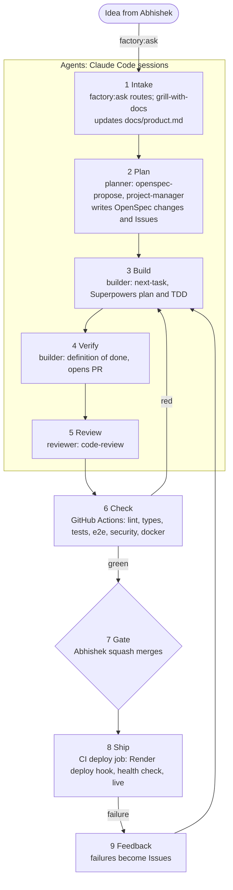
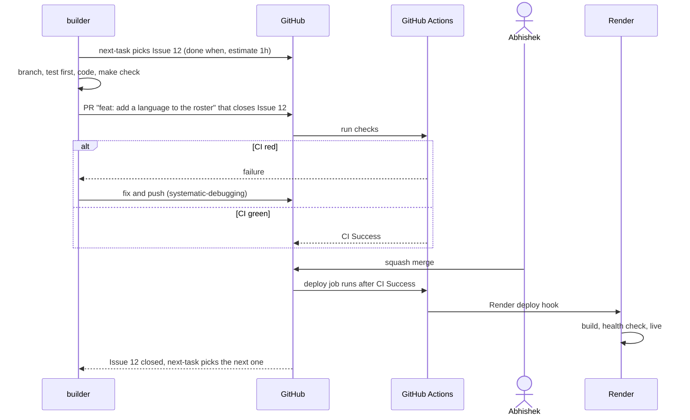

# FACTORY.md: Cantastorie Software Factory
Last updated: 21 Nov 2026

## Purpose
An agent-run pipeline that takes Cantastorie changes from an idea to a live Render deploy.
Human jobs: state the idea, answer agents, tap Merge. Everything else is the factory.
Cantastorie is the bedtime-story product: a child steers the story, a parent approves every story, in ten languages, narrated and illustrated, with no child accounts and no cookies on child paths. Live at https://cantastorie.onrender.com (repo: `darth-dodo/cantastorie`).

## Product principle
The child never meets an unreviewed story. Any Issue touching generation, review or publishing must include a safety and review-gate check in its "done when".

## Tools
| Tool | Role |
|---|---|
| Claude Code | The agent in every role, and the runtime: one session per role, builders in their own git worktree, background sessions, Remote Control for the phone |
| Matt Pocock skills | Upstream: grill, PRD, issues, code review |
| Superpowers (obra) | Downstream: plan, TDD, subagent execution, verify, finish branch |
| OpenSpec | Specs as the source of truth for behaviour: propose, validate, archive |
| GitHub | Repo, Issues (work queue), PRs |
| GitHub Actions | CI checks and the deploy job |
| Render | Deploys main (Frankfurt) |
| GitHub app + Remote Control | Human gate on the phone: merge in the GitHub app, answer blocked sessions via Claude Code Remote Control |

## Lines
| # | Line | Where | Skill / action | Output | Done when |
|---|---|---|---|---|---|
| 1 | Intake | Session `planner` | `factory:ask` routes, Matt `grill-with-docs` interviews | Updated `docs/product.md` and glossary | Committed |
| 2 | Plan | Session `planner` | `openspec-propose`, `project-manager` | `openspec/changes/<id>/`, one GitHub Issue per change | Every Issue links its change and has a "done when" |
| 3 | Build | Session `builder-<issue>` | Superpowers plan, TDD, subagents | Branch with code and tests | Tests pass locally |
| 4 | Verify | Session `builder-<issue>` | Superpowers verify, finish branch | PR | PR opened, linked to Issue |
| 5 | Review | `reviewer` (spawned by builder) | Matt `code-review` | PR review comments | No blocking comments |
| 6 | Check | GitHub Actions | Lint & Format Check, Type Check, Python Test, JS Test, E2E Test, Security Scan, Build Docker Image, R2 Bucket Audit, CI Success | CI status | Green |
| 7 | Gate | GitHub (web or mobile app) | Squash merge | Merged | Abhishek merged |
| 8 | Ship | Render, deployed by the CI `deploy` job after `CI Success` (AI-479) | Deploy hook | Live app | Health check passes |
| 9 | Feedback | Actions | Failures become Issues | New Issue | Back to line 3 |

## How it works

### The pipeline

### One Issue's life

### Guardrails that agents cannot talk past
| Risk | Stopped by | Where |
|---|---|---|
| Agent merges its own PR | `gh pr merge` denied | `.claude/settings.json` |
| Push to main, force push | Branch protection, admins included; force pushes and pushes to main denied | GitHub settings, `.claude/settings.json` |
| Broken code ships | Required `CI Success` check (lint and format, types, Python and JS tests with the coverage floor, e2e, security scan, docker build, R2 bucket audit); the deploy job runs only after it | GitHub, `.github/workflows/ci.yml` |
| Stack drift | `settled-architecture` red flags, ADR for any change | Repo |
| "Works on my machine" | Definition of done with evidence | `AGENTS.md`, PR template |
| Scope creep | New ideas go to `PHASE_2.md` | Repo |
| Overrun | 2x estimate means a cut | `project-manager` skill |
| Overlapping skills (Matt `tdd`, `diagnosing-bugs` vs Superpowers) | `Skill(skill:...)` deny rules | `.claude/settings.json` |
| An unreviewed story reaches a child | Product principle in every relevant "done when", review-gate check in the PR template | `FACTORY.md`, PR template |
| Leaked secrets | `.env` git and Docker ignored and read denied | Repo, Render |

Critical rules are enforced by machines that ignore prompts (GitHub, the permission deny list, Render). Skills only make the right path the easy one.

## Skill ownership rules
1. One owner per station. Matt owns intake (`grill-with-docs`) and review (`code-review`). OpenSpec owns specs (`openspec-propose`, `openspec-update-change`, `openspec-archive-change`). Superpowers owns build and verify. Denied in `.claude/settings.json`: `openspec-apply-change`, Matt `to-spec`, `to-tickets`, `tdd`, `diagnosing-bugs`.
2. Specs live in `openspec/specs/` and are the source of truth for behaviour. A builder implements an Issue from its change's `tasks.md` and `specs/`, then runs `openspec-archive-change` in the same PR, so specs and code merge together.
3. TDD: Superpowers only. Do not invoke Matt `tdd`.
4. At intake, invoke `grill-with-docs` explicitly; it owns the interview, not Superpowers brainstorming.
5. Run `/setup-matt-pocock-skills` once: tracker = GitHub, docs = `docs/`.

## Skills by station

Entry points (project skills, run in order, each step gated by its "done when"):

| Command | Station | Runs |
|---|---|---|
| `factory:ask <request>` | 1 Intake | Routes one request to Bug, Feature, Later, Experiment, Question, Gated or Ambiguous; creates at most one thing (a `bug` Issue, a `PHASE_2.md` line or a Candidates row), records the date and Abhishek's words, hands off to `factory:plan`, `project-manager`, `settled-architecture` or `factory:improve` |
| `factory:plan <block>` | 2 Plan | `settled-architecture`, `openspec-propose`, `openspec validate --strict`, spec PR, `project-manager` Issue, link both |
| `factory:build #N` | 3 Build, 4 Verify | `next-task`, worktree check, `superpowers:writing-plans`, `superpowers:test-driven-development`, `factory:test`, `openspec-archive-change`, PR, `factory:review` |
| `factory:test` | Verify | Every CI gate locally with real exit codes, spec scenario coverage, and the review-gate check when generation, review or publishing changed |
| `factory:pause [#N]` | Build | Saves the branch, posts a handoff comment, labels the Issue `paused` |
| `factory:resume [#N]` | Build | Restores the worktree from the branch, re-runs the gates, continues `factory:build` from the recorded step |
| `factory:cleanup` | Housekeeping | Removes local worktrees and branches whose PR merged and tree is clean; lists remote branches to delete |
| `factory:review <pr>` | 5 Review | Matt `code-review`, the definition of done checklist, blocking vs non-blocking, one PR comment |
| `factory:retro` | After 7 Gate, in batches | Once 10 merged PRs have no row: a metrics row and one lesson for each of the 10 in `~/cantastorie-factory/`; no PR |
| `factory:improve` | Flywheel | Right after each retro batch: medians, worst metric, ONE experiment PR, keep or revert the last one, folds lessons into `docs/factory/LESSONS.md` |
| `factory:release` | Flywheel | Right after each retro batch (next to `factory:improve`) or when asked: says if a release is due, proposes the version for Abhishek to confirm, hands off to the release PR (commitizen builds the changelog from Conventional Commit titles), then tags and publishes after his merge |
| `factory:recap` | Any time | Under 15 lines: merged PRs, open Issues and blockers, main CI, metric trend, new lessons; writes nothing |
| `factory:dashboard` | Any time | The visual recap: one private page rebuilt from live sources each run ("Needs Abhishek" first, then flow, quality, the running experiment), every number sourced; nothing committed |

Single-skill stations need no wrapper: intake interviews (`grill-with-docs`), ship (`render-deploy`).

## Flywheel

Every 10 merged PRs make the factory a little better, measured, one change at a time.
- `factory:retro` (checked at `factory:build` step 11): once 10 merged PRs have no row, one batch backfills all 10: one metrics row per Issue in `~/cantastorie-factory/metrics.csv` and a retro file `~/cantastorie-factory/retros/<issue>.md` with one lesson. Raw data stays outside the repo.
- `factory:improve` (right after each retro batch, which always brings at least 5 new rows): compares medians of the last 5 vs the 5 before, opens ONE experiment PR for the worst metric and logs it in `docs/factory/experiments.md`; after the next 5 it keeps or reverts it. It also folds lessons into `docs/factory/LESSONS.md`, which `factory:build` reads at step 4.
- `factory:release` (right after `factory:improve` in each batch, or when asked): checks whether a release is due and, if so, proposes the version and hands off to the release PR.
- Review reward (scored by `factory:retro`, never by the reviewer, who shares the builder's model family): each `factory:review` finding F1, F2, ... is good when a later commit changed its `file:line` with a test that fails without the change, weaker when changed untested, noise when dismissed; an escaped defect no finding flagged is a miss. `review_precision` and `review_misses` measure it after merge, because only the code and production show which findings mattered.
- `factory:recap`: the on-demand digest of where things stand.
- The repo only changes through `factory:improve` PRs; local data lost with the machine is acceptable.

## Runtime

Claude Code only:
- `planner`: lines 1 and 2. One long-lived session in the repo: `claude --remote-control planner`.
- `builder-<issue>`: one per Issue, each in its own worktree: `claude -w <issue> --remote-control builder-<issue>`, then `factory:build #<issue>`. Max 2 in parallel (avoid merge conflicts, protect API budget). Background runs: `claude --bg`, listed by `claude agents`.
- `reviewer`: a subagent the builder starts with Matt `code-review`, not a separate session.
- Blocked or done: Remote Control shows every session on the phone and pushes when a prompt or question is waiting (user setting `inputNeededNotifEnabled: true`). Resume with `claude --continue` or `--resume`.
- Fan-out inside a build: Superpowers subagents.
- New worktrees need `uv sync --extra dev` before `uv run pytest` works.

## Secrets
Names only; values live in the places below and never in the repo. `.env.example` lists the variable names.

| Secret | Lives in |
|---|---|
| `OPENROUTER_API_KEY` | Render env, local `.env`. The only key the pipeline strictly needs |
| `R2_ENDPOINT_URL`, `R2_ACCESS_KEY_ID`, `R2_SECRET_ACCESS_KEY`, `R2_BUCKET`, `R2_PENDING_BUCKET`, `R2_PUBLIC_BASE` | Render env, local `.env`. Setting `R2_ENDPOINT_URL` requires the others; publish refuses incomplete config. The CI R2 Bucket Audit job reads its own values from GitHub Actions secrets |
| `CLERK_PUBLISHABLE_KEY`, `CLERK_SECRET_KEY`, `CLERK_JWKS_URL`, `CLERK_ISSUER` | Render env, local `.env`. Gate the `/workshop` and `/parent` areas |
| `SENTRY_DSN`, `SENTRY_ENVIRONMENT` | Render env, local `.env`. Error monitoring |
| `LANGSMITH_TRACING`, `LANGSMITH_API_KEY`, `LANGSMITH_PROJECT`, `LANGSMITH_ENDPOINT` | Render env, local `.env`. Pipeline and app tracing |
| `RENDER_DEPLOY_HOOK_URL` | GitHub Actions secret. Used by the CI `deploy` job |
| `RENDER_GIT_COMMIT` | Set by Render on every deploy (not secret) |

Never commit `.env`; it is gitignored and read-denied in `.claude/settings.json`.

## Guardrails
- Kill switch: if the factory costs more time than building by hand, build by hand with Claude Code and note why in `docs/factory/LESSONS.md`.
- One Issue at a time per builder. Stop at "done when". Past 2x estimate, take the cut.
- New ideas go to `PHASE_2.md`.

## Known limits
- Sessions are local. The factory runs only while Abhishek's machine is on.
- Agents need tool permissions pre-approved, or they block (Remote Control will push).
- Any PR can pass CI and still be wrong for a child; the parent review gate and the "done when" safety check are the real defence, so they are never skipped.

## Sources
- Origin: ported from the Maya software factory (`darth-dodo/maya`, commit `ffbc7bd`) with cantastorie's own gates and product rules.
- Claude Code CLI: `claude --help` (`-w/--worktree`, `--bg`, `claude agents`, `--remote-control`)
- Superpowers: https://github.com/obra/superpowers
- Matt Pocock skills: https://github.com/mattpocock/skills
- OpenSpec: https://github.com/Fission-AI/OpenSpec
- Render: https://render.com/docs/deploy-hooks
